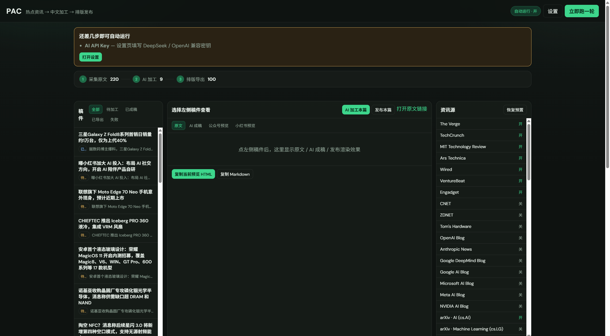
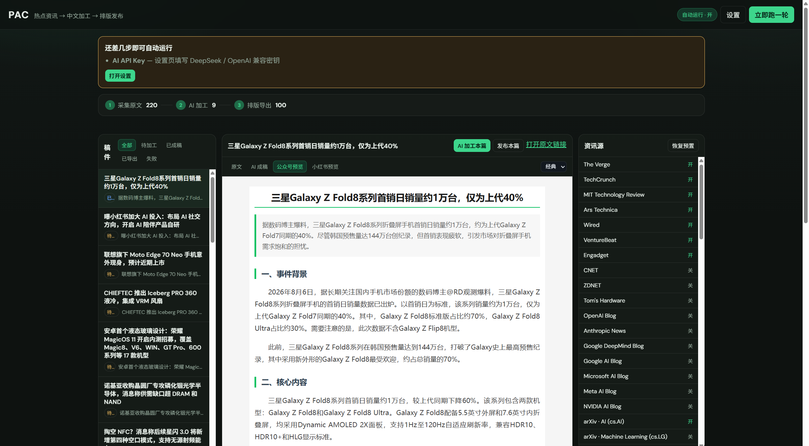
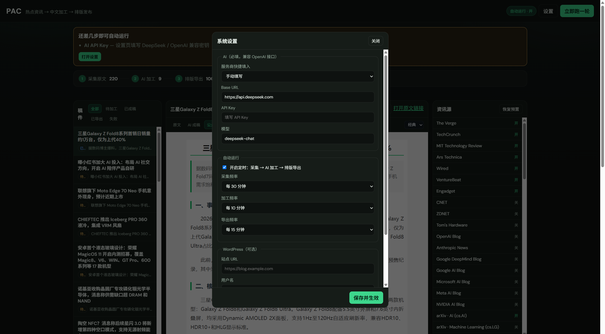

# AIPAC — AI Pipeline for Aggregate & Content

**多源采集 → AI 中文加工 → 多平台排版导出** 的轻量内容自动化工作台。

适合个人媒体、垂直号、技术博客：把热点资讯、论文摘要等内容，经 AI 整理成可直接粘贴到公众号 / 小红书 / 知乎等平台的成稿。



## 它能做什么

1. **采集**：RSS、GitHub、arXiv、网页列表、手工 URL 导入  
2. **加工**：调用 OpenAI 兼容接口（DeepSeek / 通义 / Ollama 等）生成中文标题、摘要、改写、标签  
3. **排版导出**：公众号 / 小红书 / 知乎 / 头条 Markdown + HTML；可选 WordPress 草稿；抖音可导出口播文案（ffmpeg 切片可选）

设计目标是跑在 **2G 内存 VPS** 上：Node.js 内置 SQLite + 进程内定时任务，无 MySQL / Redis。

| 能力 | 说明 |
|------|------|
| 定时流水线 | 采集 → 加工 → 导出，可网页开关 |
| Web 工作台 | 选稿、预览、复制 HTML / Markdown |
| 密钥安全 | API Key 只存本机，不上传第三方 |
| Docker | 单容器即可部署 |

## 界面预览

**稿件预览 / 公众号排版**



**系统设置（AI Key、自动运行、WordPress）**



## 快速开始

### 环境要求

- **Node.js >= 22**（使用内置 SQLite，需 `--experimental-sqlite`）
- 可选：Docker / Docker Compose
- 可选：ffmpeg（仅抖音切片需要）

### 本地运行

```bash
cp .env.example .env
npm install
npm run dev
```

浏览器打开 http://localhost:3000

### Docker

```bash
cp .env.example .env
docker compose up -d --build
```

> `.env` 与 `data/`（数据库、导出文件）已加入 `.gitignore`，**不要提交到仓库**。

## 如何使用

1. 打开右上角 **设置**，填写 AI API Key（可先选 DeepSeek 一键填入 Base URL / 模型）  
2. 右侧确认资讯源已开启；需要时点「恢复预置」  
3. 开启 **自动运行**，或点 **立即跑一轮**  
4. 左侧选择稿件，切换「原文 / AI 成稿 / 公众号预览 / 小红书预览」  
5. 用「复制 HTML / Markdown」粘贴到对应平台后台；或启用 WordPress 发草稿  

未配置 `AI_API_KEY` 时会用本地截断规则占位，方便先跑通采集与导出。

## 环境变量

复制 `.env.example` 为 `.env`。常用项：

| 变量 | 说明 |
|------|------|
| `PORT` / `HOST` | 服务端口与监听地址，默认 `3000` / `0.0.0.0` |
| `AI_BASE_URL` | OpenAI 兼容接口，如 `https://api.deepseek.com` |
| `AI_API_KEY` | AI 密钥（也可只在网页设置里填） |
| `AI_MODEL` | 模型名，如 `deepseek-chat` |
| `WP_URL` / `WP_USER` / `WP_APP_PASSWORD` | 可选 WordPress |
| `AUTO_RUN` | 是否开启定时任务 |
| `CRON_COLLECT` / `CRON_PROCESS` / `CRON_PUBLISH` | 采集 / 加工 / 导出频率 |
| `ADMIN_TOKEN` | 可选管理鉴权；设置后请求需带 `x-admin-token` |

更多说明见 `.env.example`。

## 流水线示意

```
RSS / GitHub / arXiv / web_list / URL 导入
              │
              ▼
     AI 总结 · 改写 · 标题 · 标签
              │
              ▼
 WordPress 草稿  /  Markdown·HTML 导出（公众号·小红书·知乎·头条）
```

## 扩展

- `src/collectors/` 实现 `Collector` 并注册  
- `src/publishers/` 实现 `Publisher` 并注册  
- 在工作台维护 `sources` / `publish_targets`

政府站、行业站优先找 RSS；没有再用 `web_list`（`listUrl` + `linkPattern`）。

## 合规提示

各平台开放平台与版权政策不同。自动化发布前请确认账号权限与内容授权；推荐先导出审核，再人工发布。

## License

未单独声明许可证时，请按你的开源仓库最终选定的 License 为准（建议在仓库根目录补充 `LICENSE` 文件）。
